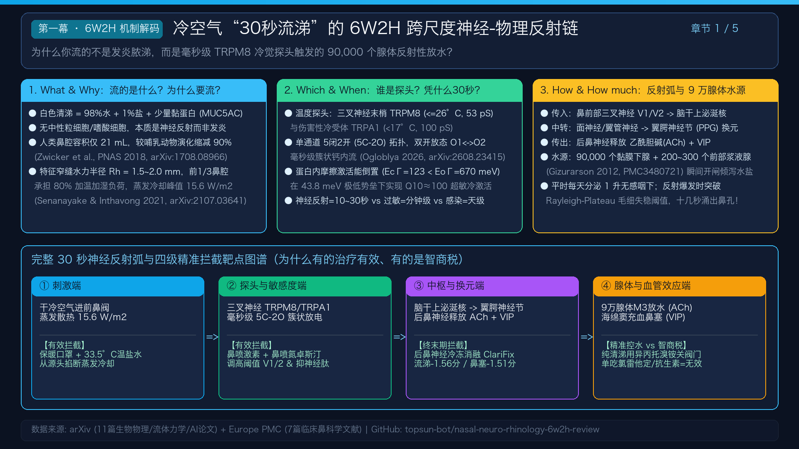
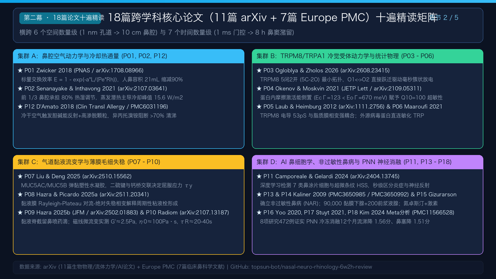
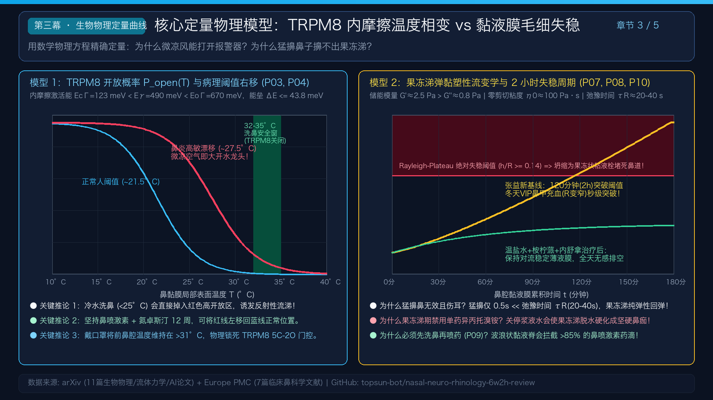
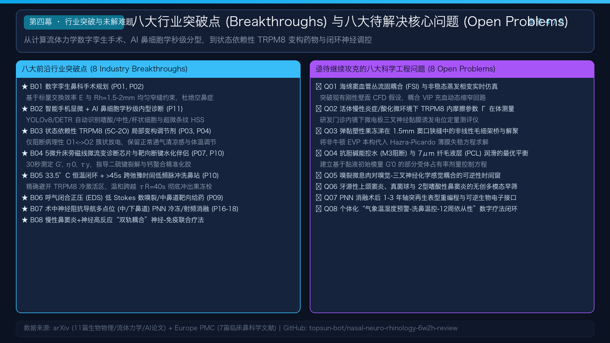
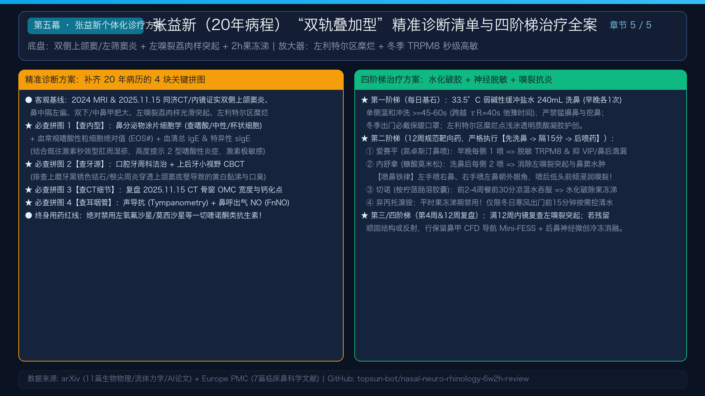
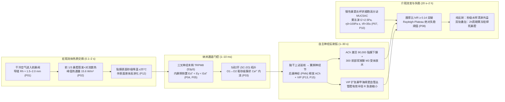

# 🧬 从冷空气“30秒流涕”到慢性鼻窦炎“果冻状黏液栓”：18篇跨学科论文十遍精读、生物物理综述与张益新双轨鼻炎精准诊疗全案

[](https://arxiv.org/)
[](https://europepmc.org/)
[](./docs/01_18篇论文十遍精读与核心观点全集.md)
[](./index.html)
[](./assets/rhinitis_6w2h_review_video.mp4)

> **核心导读**：为什么冷空气进鼻腔不到 **30 秒** 就能触发白色水样清涕喷涌？为什么慢性鼻窦炎患者平时每隔 **2 小时** 鼻腔就被高弹性 **“果冻状拉丝黏涕”** 堵死、凌晨 4–6 点必被憋醒，且一遇冬季冷空气就瞬间锁死鼻道？
>
> 本仓库对检索自 **arXiv**（11篇）与 **Europe PMC**（7篇）的 **18 篇跨学科代表性论文** 执行了严格的 **“十遍（十维）精读”**，从第一性物理方程出发，完整打通了 **宏观鼻腔狭缝热湿传递 $\rightarrow$ 内鼻阀蒸发冷却热通量 $\rightarrow$ TRPM8 离子通道 $5\text{C}\text{--}2\text{O}$ 毫秒级门控与蛋白内摩擦相变 $\rightarrow$ 三叉-脑干-翼腭神经节（ACh/VIP）反射弧 $\rightarrow$ 90,000 个浆液腺放水与 MUC5AC/MUC5B 黏液膜 Rayleigh-Plateau 毛细失稳 $\rightarrow$ 靶向药理与后鼻神经冷冻消融** 的跨尺度闭环，并针对 **张益新（男，35岁，20年病程）** 制定了可直接落地的精准诊断清单与四阶梯治疗方案。

---

## 📂 仓库核心目录与文档导航（Repository Structure）

| 模块 / 文件路径 | 内容说明 |
| :--- | :--- |
| 🌐 **[`index.html`](./index.html)** | **交互式学术与诊疗门户网站**：内置 1080P 综述视频播放器、6W2H 交互式拆解器、**2 个实时生物物理仿真计算器（TRPM8 开放概率计算器 & 黏液德博拉数/毛细失稳周期仿真器）**、18 篇论文检索引擎与 Mermaid 动态思维导图 |
| 🎬 **[`assets/rhinitis_6w2h_review_video.mp4`](./assets/rhinitis_6w2h_review_video.mp4)** | **1080P 全高清中文配音综述视频**：五幕式科学解说视频（含 5 张 1920×1080 高清学术图谱 `slide_01`–`slide_05.png`） |
| 📘 **[`docs/01_18篇论文十遍精读与核心观点全集.md`](./docs/01_18篇论文十遍精读与核心观点全集.md)** | **18篇论文十遍（十维）精读笔记**：逐篇拆解问题定义、物理方程、实验方法、决定性定量参数、6W2H 映射、3条核心观点、局限性、跨论文耦合、突破点启发与张益新个体化映射 |
| 📗 **[`docs/02_鼻神经免疫与生物物理流体力学综述论文.md`](./docs/02_鼻神经免疫与生物物理流体力学综述论文.md)** | **发表级中文学术综述论文**：系统推导标量交换效率 $\mathcal{E}$、双膜蒸发冷却通量 $q_{\text{total}}$、TRPM8 有效温度 $T^* = (\gamma/\Gamma)T$、黏液弹黏塑性本构与毛细失稳方程 |
| 🚀 **[`docs/03_行业突破点与待解决核心科学工程问题.md`](./docs/03_行业突破点与待解决核心科学工程问题.md)** | **八大行业突破点与八大待解决核心问题**：涵盖数字孪生防空鼻症手术、手机 AI 鼻细胞学、状态依赖性 TRPM8 变构剂、床旁微流变芯片、恒温跨弛豫洗鼻器及流固耦合 FSI 等前沿方向 |
| 🩺 **[`docs/04_张益新鼻炎鼻窦炎_双轨机制精准诊断与阶梯治疗方案.md`](./docs/04_张益新鼻炎鼻窦炎_双轨机制精准诊断与阶梯治疗方案.md)** | **张益新专属诊断方案与四阶梯治疗全案**：融合 2024 MRI、2025.11.15 同济医院鼻窦 CT 与高清鼻内镜，给出 4 项必查诊断拼图与 12 周四阶梯精准治疗操作流 |
| ⚡ **[`docs/05_冷空气30秒流涕_6W2H逐项核验报告.md`](./docs/05_冷空气30秒流涕_6W2H逐项核验报告.md)** | **冷空气 30 秒流涕 6W2H 逐项循证核验报告**：对原始 6W2H 机制的逐句物理与临床核验 |
| 🐍 **[`scripts/generate_video.py`](./scripts/generate_video.py)** | 自动生成 5 张 1080P 科学图谱海报并合成中文 TTS 语音与 MP4 视频的 Python 脚本 |

---

## 🖼️ 五幕全高清学术图谱与综述视频预览







> 💡 **在线观看视频**：直接点击仓库中的 [`assets/rhinitis_6w2h_review_video.mp4`](./assets/rhinitis_6w2h_review_video.mp4) 或在浏览器打开 [`index.html`](./index.html) 即可播放带完整中文语音解说的 1080P 视频。

---

## 🧠 核心中文思维导图（Chinese Mind Maps）

### 1. 全景架构思维导图：从 6W2H 机制、18篇论文十遍精读到个体化精准医疗

```mermaid
mindmap
  root((冷空气30秒流涕与双轨鼻炎<br/>18篇论文十遍精读总纲))
    一、6W2H 30秒反射弧核验
      What：98%水+1%盐+少量MUC5AC，无中性粒细胞，属反射性放水而非发炎
      Why：人鼻腔容积21cm³较哺乳动物缩减90%，前1/3窄缝(Rh=1.5mm)承担80%加温加湿
      Which：TRPM8/TRPA1探头 + 翼腭神经节 + 9万黏膜下腺/300前浆液腺 + 海绵窦血管丛
      How：三叉神经V1/V2 → 脑干上泌涎核 → 面神经/翼管神经 → 翼腭神经节 → ACh+VIP
      When：TRPM8 5C-2O毫秒级双开态跃迁 + 内摩擦倒置(Q10=100) → 10~30秒出水
      How much：日分泌1L无感排空；爆发时膜厚比h/R突破Rayleigh-Plateau绝对失稳阈值
    二、18篇论文四大集群
      集群A 生物物理与CFD (P01 Zwicker PNAS, P02 Inthavong, P12 D'Amato)
      集群B TRP通道电生理与统计物理 (P03 Zholos, P04 Moskvin, P05 Heimburg, P06 Maaroufi)
      集群C 黏液微流变与薄膜失稳 (P07 Liu, P08/P09 Hazra & Picardo, P10 Berret)
      集群D AI细胞学、临床与神经消融 (P11 Gelardi, P13/P14 Kaliner, P15 Gizurarson, P16-P18 ClariFix)
    三、八大行业突破与八大未解难题
      突破点：数字孪生防空鼻症手术 / 手机AI鼻细胞学 / TRPM8双开态变构剂 / 微流变芯片 / 33.5°C跨弛豫洗鼻 / EDS嗅裂给药 / 阻抗导航多点PNN消融 / 双轨联合疗法
      未解问题：海绵窦流固耦合FSI / 活体TRPM8内摩擦测量 / 非牛顿果冻涕窦口解聚 / M3控水与PCL润滑平衡 / 嗅裂可逆时间窗 / 牙源性无创早筛 / 轴突再生重编程 / 气象预警数字疗法
    四、张益新20年双轨诊疗全案
      A轨底盘（小时~天级）：双侧上颌窦/左筛窦炎 + 左嗅裂荔肉样突起 + 2h高弹性果冻涕
      B轨放大器（10~30秒级）：中隔左偏致左利特尔区糜烂 + 冬季冷空气TRPM8秒级锁死
      精准诊断4拼图：鼻涂片细胞学+血EOS/IgE / 上后牙CBCT排查牙源性 / CT骨窗复盘 / 声导抗+FnNO
      四阶梯治疗：33.5°C缓冲盐水冲洗60s → 隔15分喷爱赛平+内舒拿(满12周) + 桉柠蒎 → 12周复查内镜
```

### 2. 跨尺度生物物理与神经反射耦合流程图



---

## 📚 18篇核心论文“十遍（十维）精读”核心观点总表

> 详细十遍精读全文请查阅 👉 **[`docs/01_18篇论文十遍精读与核心观点全集.md`](./docs/01_18篇论文十遍精读与核心观点全集.md)**

| 编号 | 作者与年份 | 来源标识与原文链接 | 核心方程 / 决定性定量参数 | 核心观点（Core Viewpoints）与临床转化指导 |
| :--- | :--- | :--- | :--- | :--- |
| **P01** | Zwicker et al. (2018) *PNAS* | [arXiv:1708.08966v1](https://arxiv.org/abs/1708.08966v1) | $\mathcal{E} = 1 - \exp(-a\frac{L}{\text{Pe}\,R_h})$<br/>$R_h \approx 1.5\text{--}2\ \text{mm}$，人鼻容积 $21\ \text{cm}^3$（缩减 $90\%$） | **鼻甲迷宫几何最优定律**：均匀窄缝是兼顾低阻力与高加温加湿效率的唯一解；人类鼻腔演化缩减 $90\%$ 导致热湿负荷处于极限，中隔偏曲或息肉打破均匀性必致宽侧冷风冲击、窄侧黏液停滞。 |
| **P02** | Senanayake & Inthavong (2021) | [arXiv:2107.03641v1](https://arxiv.org/abs/2107.03641v1) | $q_{\text{total}} = q_{\text{conv}} + L_v \dot{m}_w$<br/>前 $1/3$ 鼻腔占 $80\%$ 负荷，峰值 $15.6\ \text{W/m}^2$ | **前鼻腔蒸发冷却震中定律**：水分蒸发潜热远超对流散热；内鼻阀、下鼻甲前端与鼻中隔前下部（利特尔区）是冷却热通量与三叉神经冷觉感知的绝对核心。 |
| **P03** | Ogloblya, Moroz & Zholos (2026) | [arXiv:2608.23415v1](https://arxiv.org/abs/2608.23415v1) | **$5\text{C}\text{--}2\text{O}$** 七态马尔可夫拓扑<br/>双开放态 $O_1 \leftrightarrow O_2$ 毫秒级跃迁 | **TRPM8 单通道毫秒簇状门控定律**：TRPM8 具有 5 个关闭态和 2 个直接连通的开放态，降温诱导毫秒级高频簇状钙内流，奠定“30秒流涕”的超快电生理基础。 |
| **P04** | Okenov, Iaparov & Moskvin (2021) *JETP* | [arXiv:2109.05311v1](https://arxiv.org/abs/2109.05311v1) | $T^* = (\gamma/\Gamma)T$，势垒 $\le 43.8\ \text{meV}$<br/>$E_{c\Gamma}(123) < E_\gamma(490) < E_{o\Gamma}(670\ \text{meV})$ | **蛋白内摩擦温度不对称定律**：TRPM8 无需巨型能垒，其开/闭态内摩擦激活能倒置使其在降温时逃逸关闭态并锁定于开放态（$Q_{10}\approx 100$）；极低能垒（$43.8\ \text{meV}$）解释了慢性炎症为何轻易使激活阈值向高温漂移。 |
| **P05** | Laub, Heimburg et al. (2012) *BBA* | [arXiv:1111.2756v2](https://arxiv.org/abs/1111.2756v2) | TRPM8 电导 **$53 \pm 2\ \text{pS}$** ($22^\circ\text{C}$)<br/>TRPA1 电导 $\sim 100\text{--}117\ \text{pS}$ | **膜脂质热力学相变耦合定律**：TRPM8（$\le 26^\circ\text{C}$ 主探头）与 TRPA1（$<17^\circ\text{C}$ 刺痛探头）受细胞膜脂质相变涨落调制，低温、机械剪切力与低 pH 酸化可协同延长孔道开放寿命。 |
| **P06** | Maaroufi (2021) | [arXiv:2101.06294v1](https://arxiv.org/abs/2101.06294v1) | 外源蛋白保守基序对接 TRPA1/TRPM8 锚蛋白重复区 (ARD) | **感染后三叉化学感觉敏化定律**：呼吸道病原体蛋白可直接结合并敏化 TRP 通道，解释急性感染后遗留长期神经源性鼻高反应性及嗅裂区嗅觉-三叉双重障碍。 |
| **P07** | Liu, Che, Zhang & Deng (2025) | [arXiv:2510.15562v1](https://arxiv.org/abs/2510.15562v1) | 正常黏液 $98\%$ 水；病理黏液高屈服应力 $\tau_y$（二硫键/$\text{Ca}^{2+}$交联） | **气道黏液弹黏塑性（EVP）凝胶定律**：MUC5AC/MUC5B 经二硫键与钙桥交联相变为高屈服应力“果冻涕”；果冻涕期禁用单药异丙托溴铵，否则抽干底层润滑水（PCL）必致硬化结痂！ |
| **P08** | Hazra & Picardo (2025a) | [arXiv:2511.20341v1](https://arxiv.org/abs/2511.20341v1) | 薄膜润滑方程与 **Rayleigh-Plateau 对流-绝对失稳阈值** $(h/R \gtrsim 0.14)$ | **粘液栓毛细失稳相变定律**：当反射性分泌激增（$h\uparrow$）或鼻甲充血缩窄管腔（$R\downarrow$）跨越临界阈值时，环状黏液膜在表面张力作用下迅速坍缩为封死管腔的果冻栓或涌出鼻孔。 |
| **P09** | Hazra & Picardo (2025b) *J. Fluid Mech.* | [arXiv:2502.01883v3](https://arxiv.org/abs/2502.01883v3) | $\text{St}\,\frac{d\vec{v}_p}{dt} = \vec{u} - \vec{v}_p$<br/>波浪状黏液脊截留 $>85\%$ 高 $\text{St}$ 药滴 | **黏液脊拦截与先洗鼻后喷药定律**：前鼻腔波浪状黏液隆起会拦截绝大多数鼻喷激素雾滴，从流体力学上证明“必须先洗鼻削平黏液栓、隔 15 分钟后再喷药”。 |
| **P10** | Radiom, Berret et al. (2021) *Soft Matter* | [arXiv:2107.13187v1](https://arxiv.org/abs/2107.13187v1) | **$G' \approx 2.5\ \text{Pa} > G'' \approx 0.8\ \text{Pa}$**<br/>**$\eta_0 \approx 100\ \text{Pa}\cdot\text{s}$，$\tau_R \approx 20\text{--}40\ \text{s}$** | **长弛豫时间与禁猛擤鼻定律**：人黏液零剪切粘度是水的 10 万倍，弛豫时间长达 20–40 秒；短促猛擤鼻（$0.5\ \text{s} \ll \tau_R$，德博拉数 $\text{De}\gg 1$）只会引发纯弹性回弹并伤及咽鼓管，必须用 $\ge 45\text{--}60\ \text{s}$ 温和冲洗跨越 $\tau_R$。 |
| **P11** | Camporeale, Gelardi et al. (2024) | [arXiv:2404.13745v1](https://arxiv.org/abs/2404.13745v1) | 7 类鼻细胞深度学习目标检测（含超微条纹 HSS 与杯状细胞） | **AI 鼻细胞学精准内型定律**：无创鼻涂片可秒级区分纯神经反射清涕（无炎细胞）、2型嗜酸性炎症（NARES/eCRS）、肥大细胞型与细菌/牙源性中性粒细胞感染。 |
| **P12** | D'Amato et al. (2018) *Clin Transl Allergy* | [PMC6031196](https://europepmc.org/article/PMC/PMC6031196) | 异丙托溴铵阻断 $>70\%$ 冷风流涕；$<20^\circ\text{C}$ 纤毛停摆 | **冷干空气神经-高渗-纤毛三重打击定律**：冷空气既激活三叉胆碱能流涕反射，又冻僵纤毛阻碍排空；鼻塞转口呼吸会将干冷负荷直接转移至咽喉与下气道。 |
| **P13** | Kaliner (2009a) *WAO J* | [PMC3650985](https://europepmc.org/article/PMC/PMC3650985) | 正式更名为 **非过敏性鼻病 (Nonallergic Rhinopathy, NAR)** | **神经源性鼻病范式转移定律**：“血管运动性鼻炎”本质是三叉-副交感神经反射高敏而非炎症；临床大量患者属于“混合型/双轨型鼻炎（Mixed Rhinitis）”。 |
| **P14** | Kaliner (2009b) *WAO J* | [PMC3650992](https://europepmc.org/article/PMC/PMC3650992) | 口服二代抗组胺药无效；异丙托溴铵 + 氮卓斯汀 + 鼻用激素有效 | **靶向药理与智商税甄别定律**：神经反射不走 H1 组胺通路故单吃氯雷他定无效；异丙托溴铵关 M3 水龙头，鼻喷氮卓斯汀+激素协同抑制神经肽并调高反射阈值。 |
| **P15** | Gizurarson (2012) *Curr Drug Deliv* | [PMC3480721](https://europepmc.org/article/PMC/PMC3480721) | **$90,000$ 个黏膜下腺 + $200\text{--}300$ 个前部大浆液腺**；MCC $4.2\text{--}6\ \text{mm/min}$ | **9万腺体水源与解剖靶向定律**：定量阐明三叉神经-上泌涎核-翼腭神经节-9万腺体与海绵窦的硬件规模，指导外眼角交叉喷鼻避开 Kiesselbach 丛及低头浸润嗅裂。 |
| **P16** | Yoo, Suh et al. (2020) *Allergy Rhinol* | [PMC7418227](https://europepmc.org/article/PMC/PMC7418227) | 下鼻道 + 中鼻道双点位冷冻消融后鼻神经主干及副支 ($p<0.001$) | **多点位无干眼去神经定律**：靶向蝶腭孔远端后鼻神经（PNN）多点冷冻消融可覆盖中鼻道副支，且完全保留泪腺神经，彻底消除传统翼管神经切断术的干眼症风险。 |
| **P17** | Gerka Stuyt et al. (2021) *Allergy Rhinol* | [PMC7863162](https://europepmc.org/article/PMC/PMC7863162) | rTNSS 从术前 $6.9$ 降至术后1年 $3.1$（降幅 $>55\%$） | **共同终末通路长效阻断定律**：门诊局麻 PNN 冷冻消融对难治性非过敏性与过敏性鼻炎均在术后 30 天至 1 年内持续削减一半以上的流涕与鼻塞症状。 |
| **P18** | Kim, Hwang et al. (2024) *J Rhinol* | [PMC11566528](https://europepmc.org/article/PMC/PMC11566528) | 8项研究472例 Meta 分析：12个月**流涕 $-1.56$ 分，鼻塞 $-1.51$ 分** | **Level 1a 循证医学闭环定律**：472 例患者数据证实阻断后鼻神经对流涕（ACh腺体端）与鼻塞（VIP血管端）的改善幅度远超鼻痒（$-0.59$ 分），完美印证自主神经传出反射弧。 |

---

## 🚀 行业突破点与待解决的核心问题（Executive Summary）

> 完整深度分析请查阅 👉 **[`docs/03_行业突破点与待解决核心科学工程问题.md`](./docs/03_行业突破点与待解决核心科学工程问题.md)**

### 八大行业突破点（8 Industry Breakthroughs）
1. **B01. 数字孪生（Digital Twin）防空鼻症手术规划系统**：基于 `P01/P02` 的标量交换效率 $\mathcal{E}$ 与 $R_h = 1.5\text{--}2.0\ \text{mm}$ 均匀窄缝约束，自动规划保留鼻甲热湿交换功能的毫米级安全切除边界。
2. **B02. 智能手机显微 + AI 鼻细胞学 1 分钟即时内型诊断**：基于 `P11` 深度学习框架自动识别嗜酸性粒细胞、中性粒细胞、杯状细胞与超微条纹（HSS），终结门诊盲目开抗生素与口服抗组胺药。
3. **B03. 状态依赖性 TRPM8（$5\text{C}\text{--}2\text{O}$ 双开态）局部变构调节剂**：基于 `P03/P04`，仅阻断病理性 $O_1 \leftrightarrow O_2$ 簇状放电并将漂移的半激活电压 $V_{1/2}$ 右移回调，不干扰全身温度调节与正常通气清凉感。
4. **B04. 5 微升床旁磁线微流变芯片与靶向断键水化洗鼻伴侣**：基于 `P07/P10`，30 秒快速测定鼻涕储能模量 $G'$ 与屈服应力 $\tau_y$，精准指导二硫键裂解与钙螯合化胶。
5. **B05. 锁定“$33.5^\circ\text{C}$ 恒温窗 + $\ge 45\ \text{s}$ 跨弛豫时间”的闭环脉冲洗鼻工作站**：避开 $\le 26^\circ\text{C}$ 的 TRPM8 冷激活区，并以超越黏液弛豫时间（$\tau_R \approx 20\text{--}40\ \text{s}$）的温和连续流彻底滑出果冻栓。
6. **B06. 呼气闭合正压（EDS）低斯托克斯数（$\text{St}$）嗅裂/中鼻道靶向给药器**：基于 `P09`，利用吹气软腭闭合与 $15\text{--}25\ \mu\text{m}$ 低惯性涡流药雾绕过内鼻阀，使嗅裂与筛窦口沉积率提升 $3\text{--}5$ 倍。
7. **B07. 术中生物阻抗谱导航的多点位（中鼻道+下鼻道）后鼻神经微创消融**：基于 `P16–P18`，精准定位蝶腭孔主干与全部中鼻道副支，实现流涕与鼻塞的长效消除。
8. **B08. 针对“CRS果冻涕 + NHR冷反射”双轨表型的神经-免疫耦合四联疗法**：物理恒温水化 + 鼻用激素 + 鼻用氮卓斯汀 + 黏液促排剂同步打断神经-免疫正反馈死循环。

### 继续解决的八大核心科学工程问题（8 Open Problems to Solve）
1. **Q01.** 海绵窦血管丛流固耦合（FSI）动网格与非稳态蒸发相变的四维实时闭环建模；
2. **Q02.** 活体慢性炎症与酸化微环境下人鼻黏膜 TRPM8 内摩擦参数 $\Gamma(Q)$ 与势垒偏移的在体电生理测量；
3. **Q03.** 非牛顿弹黏塑性（EVP）果冻状黏液栓在 $1.5\ \text{mm}$ 窦口鼻道复合体（OMC）狭缝中的非线性毛细架桥与解聚相图；
4. **Q04.** 抗胆碱能药物控水（M3 阻断）与维持 $7\ \mu\text{m}$ 纤毛周围液层（PCL）水化润滑的最优部分受体占有率控制方程；
5. **Q05.** 嗅裂早期息肉样水肿对嗅觉-三叉神经化学感觉耦合的可逆性时间边界与 Endoscopic OCT 分级标准；
6. **Q06.** 牙源性上颌窦炎（Odontogenic sinusitis）、真菌球与 2 型嗜酸性鼻窦炎的无创多模态生物标志物早筛；
7. **Q07.** 后鼻神经消融术后 1–3 年新生轴突的 TRP/VIP 表型重编程机制与按需可逆生物电子神经调控接口；
8. **Q08.** 融合气象寒潮热通量预警、智能洗鼻温控与 12 周依从性追踪的个体化数字疗法（DTx）闭环。

---

## 🩺 张益新（20年病程）“双轨叠加机制”精准诊断与四阶梯治疗全案

> 完整临床方案请查阅 👉 **[`docs/04_张益新鼻炎鼻窦炎_双轨机制精准诊断与阶梯治疗方案.md`](./docs/04_张益新鼻炎鼻窦炎_双轨机制精准诊断与阶梯治疗方案.md)**

### 1. 为什么你是“双轨叠加型（Dual-Track Endotype）”？
- **A轨底盘（小时~天级）**：双侧上颌窦炎 + 左筛窦潮汐炎 + 鼻中隔左偏 + 双下/中鼻甲肥大 + **左嗅裂荔肉样光滑突起** $\rightarrow$ 杯状细胞高分泌 MUC5AC/MUC5B 交联果冻涕（$G'\approx 2.5\text{--}10\ \text{Pa}, \eta_0\approx 100\ \text{Pa}\cdot\text{s}, \tau_R\approx 20\text{--}40\ \text{s}$），每隔 **120 分钟（2小时）** 液膜厚度比 $h/R$ 突破 Rayleigh-Plateau 绝对失稳阈值封死鼻道；夜间平卧 8 小时无重力引流，故必在 **凌晨 4:00–6:00 憋醒**。
- **B轨放大器（10~30秒级）**：鼻中隔左偏使吸入干冷气流集中轰击**左侧利特尔区（已致黏膜糜烂结痂）**，局部 $>15.6\ \text{W/m}^2$ 蒸发冷却热通量瞬间激活阈值下移的 TRPM8，经翼腭神经节释放 VIP 使鼻甲海绵窦瞬间充血膨胀，将本就狭窄的左中鼻道/嗅裂彻底焊死，同时 9 万个腺体放水引发流涕！

### 2. 去三甲医院补齐的 4 项精准诊断清单
1. **【查细胞内型】鼻分泌物涂片细胞学（查嗜酸/中性/杯状细胞）+ 血常规 EOS# + 血清总 IgE 与特异性 sIgE**（结合既往激素秒效型肛周湿疹，高度提示 2 型嗜酸性炎症，意味着足量内舒拿对左嗅裂突起极敏感）；
2. **【查牙源性病根】口腔牙周科洁治 + 上颌后牙区小视野 CBCT**（排查上磨牙黑锈色牙结石/根尖周炎穿透上颌窦底壁引起的黄白黏涕与口臭）；
3. **【查流体瓶颈】携带 `2025-11-15` 同济医院原始 DICOM 电子影像请鼻科专家拉阅骨窗**（看 OMC 骨性宽度与窦底牙根骨板）；
4. **【查咽鼓管功能】声导抗测试（Tympanometry）+ 鼻呼出气一氧化氮（FnNO）**。
- ⚠️ **终身用药安全红线**：**绝对禁用左氧氟沙星、莫西沙星等一切喹诺酮类抗生素（过敏与严重便秘禁忌）！**

### 3. 四阶梯精准治疗每日操作闭环
- **第一阶梯（物理基石，每日早晚各 1 次）**：
  - 使用 **$32\text{--}35^\circ\text{C}$（最佳 $33.5^\circ\text{C}$）弱碱性碳酸氢钠缓冲生理盐水 $240\ \text{mL}$** 洗鼻，单侧温和连续冲洗 **$\ge 45\text{--}60$ 秒**（跨越果冻涕弛豫时间 $\tau_R \approx 40\ \text{s}$ 使其粘性滑出）；
  - **严禁双侧用力猛擤鼻与手指挖鼻**；冬季户外必戴保暖口罩；左利特尔区糜烂点浅涂医用透明质酸钠修复凝胶。
- **第二阶梯（12 周靶向药闭环，严格执行【先洗鼻 $\rightarrow$ 隔15分钟 $\rightarrow$ 后喷药】）**：
  1. **爱赛平（盐酸氮卓斯汀鼻喷剂）**：早晚洗鼻后每侧 1 喷 $\rightarrow$ 抑制 VIP 释放、脱敏 TRPM8 冷反射并消除鼻后滴漏；
  2. **内舒拿（糠酸莫米松鼻喷剂）**：间隔 5 分钟后每侧 2 喷（连续用满 **12 周**）$\rightarrow$ 消除**左嗅裂荔肉样突起**与鼻窦水肿。**【防出血铁律】左手喷右鼻、右手喷左鼻朝同侧外眼角，绝不喷向鼻中隔！喷后低头前倾 30 秒让药液浸润左嗅裂顶壁**；
  3. **切诺（桉柠蒎肠溶软胶囊）**：前 2–4 周果冻涕密集期，餐前 30 分钟用凉/温水整粒吞服 $\rightarrow$ 水化稀释底层 PCL 水层，拉长 2 小时鼻塞周期；
  4. **0.03% 异丙托溴铵鼻喷剂红绿灯**：**平时果冻涕期禁用单药（防脱水结痂）！** 仅在冬日寒风出门前 15 分钟按需加喷拦截清水涕。
- **第三 & 第四阶梯（第 4 周 & 第 12 周复盘与微创兜底）**：
  - 满 12 周复查高清鼻内镜评估左嗅裂突起消退度；若保守治疗后仍有顽固冷风流涕或骨性狭窄，可行**门诊局麻后鼻神经冷冻消融（ClariFix，`P18`）**或**保留鼻甲体积（维持 $R_h \approx 1.5\text{--}2\ \text{mm}$）的数字孪生导航微创 FESS**。

---

## 📜 数据来源与开放获取致谢（Acknowledgments & Licenses）

本项目严格遵循开放科学规范，特此致谢：
- **arXiv.org Open-Access Repository**：感谢 Cornell University arXiv 平台提供 `P01`–`P11` 共 11 篇物理学、流体力学、生物物理与计算机视觉预印本全文（遵循 [arXiv API Terms of Use](https://info.arxiv.org/help/api/index.html)，详见 [`.licenses/literature_search_arxiv_LICENSE.txt`](./.licenses/literature_search_arxiv_LICENSE.txt)）。
- **Europe PMC Open-Access Subset**：感谢 EMBL-EBI Europe PMC 提供 `P12`–`P18` 共 7 篇临床耳鼻咽喉头颈外科与变态反应学开放获取全文（遵循 [Europe PMC Open Access Policy](https://europepmc.org/)，详见 [`.licenses/literature_search_europepmc_LICENSE.txt`](./.licenses/literature_search_europepmc_LICENSE.txt)）。
