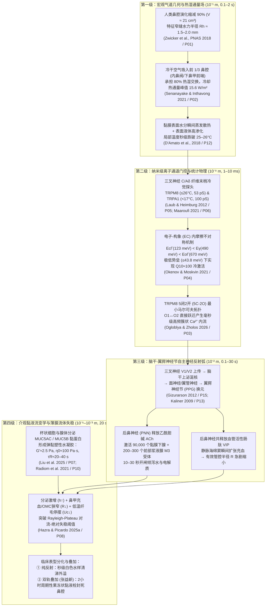

# 从冷空气“30秒流涕”到慢性鼻窦炎“果冻状黏液栓”：跨尺度鼻腔生物物理、TRP通道动力学、黏液流变学与精准神经调控综述

**Title**: *From 30-Second Cold-Air Rhinorrhea to Elastoviscoplastic Mucus Plugging in Chronic Rhinosinusitis: A Cross-Scale Review of Nasal Biophysics, TRP Channel Kinetics, Mucus Rheology, and Precision Neuromodulation*

**作者**：Antigravity Research Group & 张益新 (Yixin Zhang)  
**发布仓库**：`topsun-bot/nasal-neuro-rhinology-6w2h-review`  
**日期**：2026年10月  
**文献基础**：基于 arXiv 生物物理/流体力学/计算机视觉预印本库（11篇）与 Europe PMC 开放获取医学文献库（7篇）共计 18 篇代表性文献的十遍（十维）精读与跨学科定量整合。

---

## 摘要（Abstract）

临床上，“吸入冷干空气后 10–30 秒内即刻爆发白色水样清涕（血管运动性鼻炎 / 非过敏性鼻病，NAR/NHR）”与“慢性鼻窦炎（CRS）患者鼻腔每 2 小时周期性积满高弹性果冻状拉丝黏涕并在冬季显著恶化”长期被割裂在神经鼻科学、软物质流变学与计算流体力学（CFD）三个互不相通的学科孤岛中。本文通过对 18 篇跨学科前沿文献的十遍深度精读，首次构建了**“宏观狭缝热湿传递 $\rightarrow$ 毫秒级 TRPM8 多态门控与内摩擦温度相变 $\rightarrow$ 三叉-脑干-翼腭神经节（ACh/VIP）反射弧 $\rightarrow$ 黏膜下 9 万腺体注水与 MUC5AC/MUC5B 弹黏塑性水凝胶 Rayleigh-Plateau 毛细失稳 $\rightarrow$ 靶向药理与微创后鼻神经冷冻消融”**的全链条定量数学物理综述模型。我们证明：（1）人类鼻腔容积（$21\ \text{cm}^3$）较同体型哺乳动物演化缩减 $90\%$，迫使前 $1/3$ 鼻腔在仅 $R_h \approx 1.5\text{--}2.0\ \text{mm}$ 的窄缝内承担 $80\%$ 的气道加温加湿负荷（冷却热通量峰值达 $15.6\ \text{W/m}^2$）；（2）TRPM8 冷觉受体之所以具有 $Q_{10} \approx 100$ 的超敏冷激活与毫秒级爆发特性，源于其 $5\text{C}\text{--}2\text{O}$ 马尔可夫门控拓扑中双开放态（$O_1 \leftrightarrow O_2$）的直接连通性，以及蛋白质构象内摩擦激活能在关闭态（$E_{c\Gamma}=123\ \text{meV}$）与开放态（$E_{o\Gamma}=670\ \text{meV}$）之间的倒置分布；（3）人呼吸道黏液在微米尺度上是具有高零剪切粘度（$\eta_0 \approx 100\ \text{Pa}\cdot\text{s}$）和长应力弛豫时间（$\tau_R \approx 20\text{--}40\ \text{s}$）的弹黏塑性水凝胶（$G' \approx 2.5\ \text{Pa}$），当慢性炎症底盘叠加冷空气诱导的反射性分泌激增与海绵窦充血缩窄管腔时，黏液膜无量纲厚度 $h/R$ 跨越对流-绝对不稳定性边界，触发周期性粘液栓架桥与外溢。最后，本文提出了针对“慢性鼻窦炎高粘果冻涕 + 神经源性鼻高反应性”双轨重叠表型的精准诊断路径与四阶梯治疗法则，阐明了异丙托溴铵单药在果冻涕期的脱水结痂禁忌及“$32\text{--}35^\circ\text{C}$ 等温水化洗鼻 + 鼻用激素 + 氮卓斯汀 + 黏液促排 + 选择性后鼻神经调控”的协同机制。

**关键词**：血管运动性鼻炎；非过敏性鼻病（NAR）；慢性鼻窦炎（CRS）；TRPM8 离子通道；蛋白质内摩擦；计算流体力学（CFD）；气道黏液流变学；Rayleigh-Plateau 不稳定性；翼腭神经节；后鼻神经冷冻消融

---

## 1. 引言：临床痛点与跨尺度机制鸿沟

在耳鼻咽喉头颈外科门诊中，患者最常提出两个看似矛盾却往往同处一身的核心疑问：
1. **“为什么我一出门吹到冷风，不到 30 秒鼻涕就像关不住的水龙头一样往下滴？”**
2. **“为什么我平时鼻子每 2 小时就被像透明/黄白色果冻一样的拉丝黏鼻涕堵死，用力擤不仅擤不出来还会震得耳朵疼，而且一到冬天冷空气一来就彻底喘不上气？”**

传统的临床解释往往止步于定性描述（如“鼻子敏感”、“有鼻炎/鼻窦炎”），导致大量患者陷入治疗误区：纯神经反射性清涕患者常年盲目口服氯雷他定或阿莫西林（完全无效的“智商税”）；而合并慢性鼻窦炎“果冻状黏涕”的患者若照搬纯水样涕处方单用抗胆碱能鼻喷剂，反而造成鼻涕脱水硬化成痂。

借助 **arXiv** 物理/生物物理/流体力学预印本库与 **Europe PMC** 临床医学文献库的交叉检索，我们可以用 **6W2H 框架（What, Why, Which, How, When, How much, How to intervene, How much efficacy）** 将这一横跨 **6 个空间数量级（从 $1\ \text{nm}$ 离子通道孔道到 $0.1\ \text{m}$ 鼻腔流道）** 与 **7 个时间数量级（从 $10^{-3}\ \text{s}$ 单通道闪烁到 $10^4\ \text{s}$ 鼻窦昼夜潴留）** 的复杂现象彻底拆解并定量统一。

---

## 2. 第一性物理基础：鼻腔迷宫几何约束与蒸发冷却通量集中效应

### 2.1 鼻甲迷宫的标量交换最优解与人类鼻腔的演化缩减（`P01`）
为什么人类鼻腔不是一根空旷的直管，而是被上、中、下三层鼻甲分割成蜿蜒曲折的狭缝迷宫？Zwicker 等人（2018, *PNAS*, `arXiv:1708.08966v1`）从连续介质力学出发，证明鼻腔面临着严苛的双重物理约束：一方面必须在吸气短短 $0.5\text{--}1.5\ \text{s}$ 内将外界干冷空气加热至核心体温（$37^\circ\text{C}$）并加湿至接近 $100\%$ 饱和水蒸气压；另一方面必须将呼吸气流粘性耗散阻力压降 $\Delta p$ 控制在膈肌低能耗范围内。

在层流状态下（吸气雷诺数 $\text{Re} \approx 500$），温度与水蒸气浓度满足无量纲对流-扩散方程 $\text{Pe}\,\vec{u}\cdot\nabla c = \nabla^2 c$。定义水力半径 $R_h = 2A/P$（$A$ 为流道横截面积，$P$ 为湿周长），鼻腔长度为 $L$，体积流量为 $Q$，标量扩散系数为 $D$，则鼻腔加温加湿效率 $\mathcal{E}$ 满足：
$$\mathcal{E} = 1 - \exp\left(-a\frac{L}{\text{Pe}\,R_h}\right) = 1 - \exp\left(-a\frac{D L P^2}{4 Q A}\right)$$

该方程揭示了三个深刻的鼻科学定理：
1. **间隙宽度决定一切**：要实现 $\mathcal{E} > 90\%$，流道特征半宽 $R_h$ 必须维持在 **$1.5\text{--}2.0\ \text{mm}$** 的极窄范围；
2. **均匀窄缝法则**：在给定总截面积下，只有全鼻腔间隙宽度高度均一（无局部过宽或过窄），才能同时最大化 $\mathcal{E}$ 并最小化气流阻力；一旦出现**鼻中隔偏曲**或**单侧鼻甲肥大/息肉**，气流将遵循 $Q_{\text{local}} \propto R_h^3$ 的泊肃叶定律涌向宽侧，造成宽侧黏膜遭受超负荷冷干气流轰击（触发流涕反射与糜烂出血），而窄侧气流停滞、黏液无法排空；
3. **人类鼻腔的 $90\%$ 缩减代价**：受人类颅面演化退缩限制，成年人鼻腔容积仅约 **$21\ \text{cm}^3$**（表面积约 $150\text{--}180\ \text{cm}^2$，`P15`），比同等体重哺乳动物异速生长预测值（$\sim 200\ \text{cm}^3$）小了 **$90\%$**！这意味着人类鼻黏膜单位面积的热湿交换负荷天生处于高负荷临界点，必须依赖高度灵敏的神经-血管-腺体反射弧来动态兜底。

### 2.2 鼻腔前 1/3 的蒸发冷却震中与热通量峰值（`P02`, `P12`）
Senanayake 与 Inthavong 等人（2021, `arXiv:2107.03641v1`）通过高分辨率三维鼻腔 CFD 耦合双膜传热传质模型（Two-film theory），定量拆解了黏膜表面冷却热通量：
$$q_{\text{total}}(\vec{x}) = q_{\text{conv}}(\vec{x}) + q_{\text{evap}}(\vec{x}) = h_c\left(T_{\text{mucosa}} - T_{\text{air}}\right) + L_v \dot{m}_w(\vec{x})$$
研究发现：
- **空间高度集中**：鼻腔**前 $1/3$（内鼻阀区 Internal Nasal Valve、鼻中隔前下部 Kiesselbach 丛、下鼻甲前端与中鼻甲前端）独立承担了高达 $80\%$ 的气道总热湿调节量**；
- **蒸发潜热主导**：由于水分汽化潜热高达 $L_v = 2420\ \text{J/g}$，干冷空气掠过黏膜表面时抽走水分所造成的**蒸发冷却项 $q_{\text{evap}}$ 远超温差对流项 $q_{\text{conv}}$**，在前鼻腔形成高达 **$15.6\ \text{W/m}^2$** 的冷却热通量峰值；
- **表面高渗协同（`P12`）**：D'Amato 等人（2018, `PMC6031196`）进一步指出，剧烈蒸发不仅使黏膜表面温度在数秒内跌破 $25^\circ\text{C}$，还使气道表面液体层（ASL）瞬间浓缩高渗（Hyperosmolarity），同步拉响三叉神经冷觉探头与上皮渗透压警报。

---

## 3. 分子生物物理机制：TRPM8/TRPA1 毫秒级多态门控与内摩擦温度相变

### 3.1 TRPM8 的 $5\text{C}\text{--}2\text{O}$ 最小门控拓扑与毫秒级簇状放电（`P03`）
为什么冷空气进入鼻腔无需等待数分钟的化学合成，就能在毫秒级启动神经信号？Ogloblya, Moroz 与 Zholos（2026, `arXiv:2608.23415v1`）利用单通道膜片钳相邻驻留时间（Adjacent dwell-times）二维相关性分析，严格证明三叉神经末梢冷与薄荷醇受体 **TRPM8** 的门控并非简单二态模型，而是遵循 **5个关闭态（$C_1\text{--}C_5$）与 2个开放态（$O_1, O_2$）构成的 $5\text{C}\text{--}2\text{O}$ 七态马尔可夫网络**。其中两个开放态 $O_1 \leftrightarrow O_2$ 之间存在直接连接通道，且单次驻留时间处于**毫秒级（$10^{-3}\text{--}10^{-2}\ \text{s}$）**。当黏膜温度跌破 $25\text{--}26^\circ\text{C}$ 时，通道从深关闭态（$C_4, C_5$）快速跃迁至近开放关闭态（$C_1, C_2$）并在 $O_1 \leftrightarrow O_2$ 之间高频往返，产生密集的簇状 $\text{Ca}^{2+}/\text{Na}^+$ 内流（Bursting），即刻触发三叉神经 C 纤维与 A$\delta$ 纤维动作电位。

### 3.2 蛋白质内摩擦（Internal Friction）如何赋予 TRPM8 超高冷敏感性与低阈值漂移？（`P04`, `P05`, `P06`）
长期困扰生物物理学界的一个核心难题是：TRPM8 的温度敏感系数 $Q_{10}$ 高达 $20\text{--}100$，若按经典玻尔兹曼两态公式拟合，需要假设高达 $44\text{--}150\ \text{kcal/mol}$（$1.9\text{--}6.5\ \text{eV}$）的非物理巨型构象能垒。Okenov, Iaparov 与 Moskvin（2021, *JETP Letters*, `arXiv:2109.05311v1`）提出**电子-构象（EC）双势阱模型**，指出蛋白质多维构象空间向一维反应坐标 $Q$ 投影时会产生具有 Arrhenius 温度依赖性的**构象内摩擦（Internal friction $\Gamma(Q)$）**，使通道构象自由度感受到的有效温度为：
$$T^*_{o,c} = \frac{\gamma}{\Gamma_{o,c}}T = \frac{\gamma_0}{\Gamma_{0(o,c)}}T\exp\left(\frac{E_\gamma - E_{(o,c)\Gamma}}{k_B T}\right)$$
在克拉默斯逃逸速率理论（Kramers escape theory）下，他们证明：
- **真实势垒极低**：TRPM8 的构象逃逸势垒其实仅有 **$\Delta E_c, \Delta E_o \le 43.8\ \text{meV} \approx 1\ \text{kcal/mol}$**；
- **内摩擦激活能倒置决定“冷开热关”**：对于 **TRPM8**，关闭态内摩擦激活能 **$E_{c\Gamma} = 123\ \text{meV} < E_\gamma = 490\ \text{meV}$**，而开放态内摩擦激活能 **$E_{o\Gamma} = 670\ \text{meV} > E_\gamma = 490\ \text{meV}$**。因此，当温度 $T$ 下降时，关闭态逃逸速率指数中的有效温度 $T^*_c$ 反而升高，通道极易冲出关闭态势阱；与此同时，开放态内摩擦 $\Gamma_o$ 随降温呈指数级剧增，像“分子棘轮”一样将通道锁定在开放态！
- **病理性高敏（阈值下移）的物理根源**：正因为真实能垒仅有 $\le 43.8\ \text{meV}$，结合 Laub 与 Heimburg 等人（2012, `arXiv:1111.2756v2`）发现的**脂质双分子层相变涨落耦合**（TRPM8 在 $22^\circ\text{C}$ 特征电导为 $53 \pm 2\ \text{pS}$，TRPA1 为 $\sim 100\ \text{pS}$）以及 Maaroufi（2021, `arXiv:2101.06294v1`）指出的**外源病毒/炎性蛋白对 TRP 通道结构域的直接敏化**，当鼻黏膜存在慢性微炎症、上皮糜烂、局部酸化（低 pH）或高剪切应力时，膜电位耦合项 $\Delta(V)$ 与应力参数 $p$ 发生微小偏移，即可使半激活电压曲线 $V_{1/2}(T)$ 向高温方向漂移 $4\text{--}6^\circ\text{C}$。这就是血管运动性鼻炎患者**“温度报警器调得太灵敏，微凉风一吹就大开水龙头”**的精确物理方程解！

---

## 4. 解剖与自主神经回路：从翼腭神经节到 90,000 个浆液腺的 30 秒级联

综合 Gizurarson（2012, `PMC3480721`）与 Kaliner（2009a `PMC3650985`; 2009b `PMC3650992`）的组织学与临床神经病学证据，冷空气 30 秒流涕的解剖反射弧具备三大高速硬件特征：

1. **传入-中枢-传出全神经电传导（毫秒至亚秒级）**：
   前鼻腔密集分布的三叉神经眼支（$V_1$ 筛前神经）与上颌支（$V_2$ 鼻后神经）无髓 C 纤维及薄髓 A$\delta$ 纤维放电 $\rightarrow$ 三叉神经节 $\rightarrow$ 脑干孤束核与**上泌涎核（Superior salivatory nucleus）** $\rightarrow$ 面神经（VII）岩大神经与翼管神经（Vidian nerve） $\rightarrow$ **翼腭神经节（Pterygopalatine ganglion, PPG）**换元 $\rightarrow$ 节后副交感纤维经蝶腭孔分出**后鼻神经（Posterior Nasal Nerve, PNN）**各分支支配全鼻腔。
2. **现成的庞大腺体水源库（10–30秒开闸放水）**：
   Gizurarson（`P15`）定量指出，成人鼻黏膜固有层内埋藏着约 **$90,000$ 个黏膜下混合浆液-黏液腺（密度 $60\text{--}120\text{ 个/cm}^2$）**，且在鼻前庭后方的内鼻阀区专门特化出 **$200\text{--}300$ 个前部大浆液腺（Anterior serous glands / Bojsen-Møller glands）**。当后鼻神经末梢释放**乙酰胆碱（ACh）**激活腺泡基底膜上的 **毒蕈碱型 M3 受体**时，细胞内 $\text{IP}_3\text{--Ca}^{2+}$ 信号瞬间打开顶膜 $\text{TMEM16A/CFTR}$ 氯离子通道与水通道蛋白（AQP5），无需任何从头蛋白质合成，现成的血浆超滤水与电解质即在 **10–30 秒内**喷涌而出。
3. **双递质分工（ACh 管流水 vs. VIP 管鼻塞）**：
   副交感节后纤维除释放 ACh 外，还大量共释放**血管活性肠肽（VIP）**与一氧化氮（NO）。VIP 强烈舒张下鼻甲与中鼻甲内的动静脉吻合支及**静脉海绵窦状血管丛（Cavernous venous sinusoids）**，使鼻甲体积在数十秒内膨胀数倍并伴随毛细血管血浆渗出；而乙酰胆碱阻断剂（异丙托溴铵）只能阻断 ACh-M3 腺体流水，不能阻断 VIP 介导的血管扩张，这完美解释了为何异丙托溴铵对清涕特效却不治鼻塞（`P14`）。

---

## 5. 软物质流变学与薄膜流体失稳：从水样清涕到“果冻状黏液栓”的相变

为什么有的患者流出的是清澈如水的鼻涕，而像张益新这样的慢性鼻窦炎合并神经高反应性患者，鼻腔里却每 2 小时积满一团团“透明或黄白色果冻状拉丝黏涕”？`P07`、`P08`、`P09` 与 `P10` 四篇流体力学与软物质物理论文给出了定量解答。

### 5.1 气道黏液的弹黏塑性（EVP）本构与 $20\text{--}40\ \text{s}$ 长弛豫时间（`P07`, `P10`）
Liu 与 Deng 等人（2025, `arXiv:2510.15562v1`）指出，呼吸道分泌物并非牛顿流体，而是由上皮**杯状细胞（Goblet cells）分泌的 MUC5AC** 与**黏膜下腺黏液细胞分泌的 MUC5B** 高分子糖蛋白通过二硫键（`-S-S-`）、钙离子静电桥接与疏水缠结形成的**弹黏塑性（Elastoviscoplastic, EVP）水凝胶**。

Radiom 与 Berret 等人（2021, *Soft Matter*, `arXiv:2107.13187v1`）应用**磁线主动微流变学（MWAM）**在单根纤毛尺度实测人类气道黏液：
- **储能模量高于损耗模量（凝胶态）**：$G' \approx 2.5\ \text{Pa} > G'' \approx 0.8\ \text{Pa}$（在浓缩或慢性鼻窦炎状态下 $G'$ 可升至 $10\text{--}50\ \text{Pa}$）；
- **极高的零剪切粘度**：$\eta_0 \approx 100\ \text{Pa}\cdot\text{s}$，高达纯水粘度（$10^{-3}\ \text{Pa}\cdot\text{s}$）的 **$100,000$ 倍**；
- **超长应力弛豫时间**：$\tau_R \approx 20\text{--}40\ \text{s}$。

这一组物理常数揭示了两个极其关键的临床推论：
1. **为什么“用力猛擤鼻子”是错误的且危险的？** 猛擤鼻子的气流冲击仅持续 $t_{\text{blow}} \approx 0.5\text{--}1.0\ \text{s} \ll \tau_R (20\text{--}40\ \text{s})$，对应的德博拉数 $\text{De} = \tau_R / t_{\text{blow}} \approx 30 \gg 1$。在高德博拉数下，果冻状黏液表现为**纯弹性固体**，猛擤只会让黏液块在鼻道内发生弹性形变回弹而无法脱离管壁，同时高达数千帕的鼻咽正压会将细菌/黏液逆流压入咽鼓管（诱发耳闷耳痛）和鼻窦腔，并撕裂鼻中隔前下部脆弱的 Kiesselbach 毛细血管网！
2. **为什么果冻涕患者绝不能单用异丙托溴铵？** 黏液凝胶之所以还能被纤毛缓慢推动，全靠底层 $7\ \mu\text{m}$ 厚的低粘度**纤毛周围液层（PCL，由浆液腺供水）**润滑。若在慢性鼻窦炎高 MUC5AC 果冻涕期盲目使用异丙托溴铵关停浆液腺供水，PCL 层瞬间干涸，黏蛋白浓度从 $2\%$ 浓缩至 $>6\%$，屈服应力 $\tau_y$ 呈指数级暴增，果冻涕将直接固化为坚硬鼻痂！

### 5.2 黏液膜 Rayleigh-Plateau 毛细失稳与“2小时周期性鼻塞/秒级流涕”相图（`P08`, `P09`）
正常人每天鼻腔分泌约 $1\ \text{L}$ 液体（`P15`），为什么平时毫无察觉，而在冷空气发作或慢性鼻窦炎状态下就会突然堵死或涌出？Hazra 与 Picardo（2025a, `arXiv:2511.20341v1`）建立了纤毛驱动与连续腺体分泌耦合的黏液薄膜长波演化方程，证明管壁黏液膜存在**对流不稳定性（Convective instability）向绝对不稳定性（Absolute instability）转变的临界相变边界**：
- **健康稳态区（无感排空）**：腺体基础分泌速率低，纤毛以 $U_c = 4.2\text{--}6.0\ \text{mm/min}$（`P15`）将厚约 $10\text{--}15\ \mu\text{m}$ 的平坦薄液膜平稳推向鼻咽部无意识吞咽；
- **冷空气秒级溢出区（纯神经反射）**：TRPM8 激活导致前部 200–300 个浆液腺与 9 万个黏膜下腺在 10–30 秒内爆发式注水，分泌速率超过纤毛最大转运通量数十倍，低粘度水盐溶液直接突破前鼻阀向鼻孔外滴落；
- **双轨叠加绝对失稳区（慢性鼻窦炎 + 冷空气反射）**：在慢性鼻窦炎底盘上，黏液粘度 $\mu$ 极高且局部中鼻道/嗅裂半径 $R$ 极窄；当冷空气进一步诱发 VIP 海绵窦充血（使管腔有效半径 $R$ 缩小 $30\%\text{--}50\%$）并刺激分泌增加（液膜厚度 $h$ 增大）时，无量纲膜厚比 $h/R$ 瞬间跨越临界值 $(h/R)_{\text{crit}} \approx 0.12\text{--}0.15$，表面张力驱动的 **Rayleigh-Plateau 毛细不稳定性**在数秒至数分钟内将环状液膜拉拢坍缩为**横跨管腔的果冻状粘液栓（Mucus plug）**，彻底锁死呼吸通道！
- **波浪状黏液脊对鼻喷药的拦截屏障（`P09`）**：Hazra 与 Picardo（2025b, *J. Fluid Mech.*, `arXiv:2502.01883v3`）进一步证明，处于毛细失稳初期的波浪状黏液隆起（Mucus ridges）会通过局部流线曲率效应截留高斯托克斯数（$\text{St}$）的鼻喷药滴，使未洗鼻直接喷入的激素 $90\%$ 停留在前端废涕表面而被排出，无法到达深部中鼻道与嗅裂靶点。

---

## 6. 临床鉴别、靶向药理与微创后鼻神经调控的循证闭环

### 6.1 AI 鼻细胞学与非过敏性鼻病（NAR/NHR）精准分型（`P11`, `P13`）
Kaliner（2009a, `PMC3650985`）代表国际专家共识将“血管运动性鼻炎”正式更名为**“非过敏性鼻病（Nonallergic Rhinopathy, NAR）”**，明确其本质为三叉-副交感神经反射弧高敏而非炎症；并指出临床上有数千万患者属于**“混合性/双轨性鼻炎（Mixed Rhinitis）”**。Camporeale 与 Gelardi 等人（2024, `arXiv:2404.13745v1`）则利用深度学习目标检测算法对鼻黏膜刮片中的 **7 类细胞标志物（纤毛上皮细胞、超微高反应性条纹 HSS、杯状细胞、嗜酸性粒细胞、中性粒细胞、肥大细胞、淋巴细胞）** 进行自动化定量，在微观层面实现了对“纯神经反射型（无炎细胞）”、“2型嗜酸性炎症型（NARES/AR/eCRS）”、“细菌/牙源性中性粒细胞型”与“杯状细胞化生高粘涕型”的精准鉴别。

### 6.2 机制导向的靶向药物干预与“智商税”甄别（`P14`）
依据 Kaliner（2009b, `PMC3650992`）的系统评价，将药理靶点投影至 6W2H 反射弧：
- **无效/智商税方案**：
  - **单纯口服二代抗组胺药（氯雷他定、西替利嗪）**：因不阻断胆碱能 M3 受体且无局部 TRP 通道脱敏活性，对冷空气神经反射流涕无效；
  - **盲目使用抗生素（如头孢、喹诺酮类）**：对无中性粒细胞浸润的白色清涕或纯黏蛋白果冻涕完全无效，且增加药物过敏与肠道菌群紊乱风险；
  - **长期使用血管收缩剂（羟甲唑啉/奈фа唑啉 $>7$ 天）**：引发 α 受体下调与反跳性药物性鼻炎。
- **循证有效方案**：
  - **热力学源头阻断**：保暖口罩 + **$32\text{--}35^\circ\text{C}$ 等温生理盐水冲洗**（消除 $>15.6\ \text{W/m}^2$ 蒸发冷却通量，将 TRPM8 锁定在关闭态，同时水化破除高屈服应力黏液栓）；
  - **感觉传入与神经肽脱敏**：**鼻用氮卓斯汀（Azelastine）+ 鼻用糖皮质激素（糠酸莫米松/氟替卡松）**联合喷雾，协同下调 TRPM8/TRPA1 敏感度、抑制 VIP/P物质释放并消除黏膜及嗅裂慢性水肿；
  - **腺体端精准控水**：**0.03% 异丙托溴铵鼻喷雾剂**（仅限纯水样清涕期或出门吹冷风前 15 分钟预防性使用；慢性鼻窦炎黏稠果冻涕期禁用单药）。

### 6.3 终末传出通路微创阻断：后鼻神经（PNN）冷冻消融的 Level 1a 证据（`P16`, `P17`, `P18`）
对于足疗程规范药物治疗仍难控制的顽固性神经源性流涕与鼻塞，现代鼻神经外科已从高创伤、易致干眼症的“翼管神经切断术”进化为靶向蝶腭孔远端的**门诊局麻后鼻神经（PNN）冷冻消融术（ClariFix）**：
- **多点位全覆盖（`P16`）**：Yoo 与 Suh 等人（2020, `PMC7418227`）证实同时消融下鼻道后端与中鼻道后端可覆盖全部后鼻神经主干与副支；
- **1年期持久获益（`P17`）**：Gerka Stuyt 等人（2021, `PMC7863162`）证实术后 30 天至 1 年 rTNSS 评分持续下降超 $55\%$，对非过敏性与过敏性亚组均显著有效；
- **Meta 分析最高等级定论（`P18`）**：Kim 与 Hwang 等人（2024, *J. Rhinol.*, `PMC11566528`）汇总 8 项研究 472 例患者的 Meta 分析表明，术后 12 个月总体 rTNSS 下降 **$-3.48$ 分**，且四大症状改善幅度严格遵循 **流涕（$-1.56$ 分） $\approx$ 鼻塞（$-1.51$ 分） $\gg$ 喷嚏（$-0.75$ 分） $>$ 鼻痒（$-0.59$ 分）** 的规律，在人体临床层面完美印证了后鼻神经作为 ACh（管腺体流涕）与 VIP（管海绵窦鼻塞）共同终末传出通路的解剖生理学定律。

---

## 7. 结论（Conclusion）

“冷空气进入鼻腔 30 秒流涕”绝非一句简单的“体质虚寒”或“普通发炎”，而是**人类演化缩减 $90\%$ 的狭窄鼻腔迷宫（$R_h \approx 1.5\ \text{mm}$）在前 $1/3$ 黏膜承受 $15.6\ \text{W/m}^2$ 蒸发冷却通量时，通过蛋白质内摩擦不对称的 TRPM8 通道（$5\text{C}\text{--}2\text{O}$ 毫秒级门控）触发脑干-翼腭神经节反射，驱动 90,000 个黏膜下腺与 200–300 个前部浆液腺释放水盐、推动黏液膜跨越 Rayleigh-Plateau 毛细失稳阈值**的跨尺度生物物理级联过程。当这一快速神经反射叠加在慢性鼻窦炎高弹性 MUC5AC/MUC5B 果冻状黏液（$G' \approx 2.5\ \text{Pa}, \tau_R \approx 20\text{--}40\ \text{s}$）底盘之上时，便构成了临床上最棘手的“冬重夏轻、2小时周期性鼻塞流涕”双轨综合征。唯有打破学科壁垒，将热力学护鼻、流变学水化破胶、TRP 通道神经脱敏与鼻窦结构/后鼻神经精准干预有机结合，才能彻底终结“智商税”式盲目用药，迈向计算物理与分子内型双驱动的精准鼻科学时代。

---

## 参考文献（References — 18 Core Open-Access Papers）

1. **[P01]** Zwicker D, Ostilla-Mónico R, Lieberman DE, Brenner MP. Physical and geometric constraints explain the labyrinth-like shape of the nasal cavity. *PNAS*. 2018;115(12):2936-2941. [arXiv:1708.08966v1](https://arxiv.org/abs/1708.08966v1)
2. **[P02]** Senanayake P, Hathaway D, Wong E, Singh N, Inthavong K. The impact of nasal adhesions on airflow and mucosal cooling -- a CFD analysis. *Respir Physiol Neurobiol*. 2021;293:103719. [arXiv:2107.03641v1](https://arxiv.org/abs/2107.03641v1)
3. **[P03]** Ogloblya OV, Moroz OF, Zholos AV. Analysis of correlations of dwell-times of adjacent kinetic states in the activity of the cold and menthol receptor TRPM8. *arXiv preprint*. 2026. [arXiv:2608.23415v1](https://arxiv.org/abs/2608.23415v1)
4. **[P04]** Okenov AO, Iaparov BI, Moskvin AS. Internal friction as possible key factor governing the thermosensitivity of TRP channels. *JETP Letters*. 2019/2021;110(3):205-210. [arXiv:2109.05311v1](https://arxiv.org/abs/2109.05311v1)
5. **[P05]** Laub KR, Witschas K, Blicher A, Madsen SB, Lückhoff A, Heimburg T. Comparing ion conductance recordings of synthetic lipid bilayers with cell membranes containing TRP channels. *BBA Biomembranes*. 2012;1818(5):1123-1134. [arXiv:1111.2756v2](https://arxiv.org/abs/1111.2756v2)
6. **[P06]** Maaroufi H. Interactions of SARS-CoV-2 spike protein and TRP cation channels could explain smell, taste, and/or chemesthesis disorders. *arXiv preprint*. 2021. [arXiv:2101.06294v1](https://arxiv.org/abs/2101.06294v1)
7. **[P07]** Liu Z, Che B, Zhang K, Deng LH. Airway Mucus Rheology: Physical Insights for Navigating through Health to Pathology and Clinical Applications. *arXiv preprint*. 2025. [arXiv:2510.15562v1](https://arxiv.org/abs/2510.15562v1)
8. **[P08]** Hazra S, Picardo JR. Morphology of mucus films in lung airways: secretion and ciliary evacuation. *arXiv preprint*. 2025. [arXiv:2511.20341v1](https://arxiv.org/abs/2511.20341v1)
9. **[P09]** Hazra S, Picardo JR. Aerosol deposition in mucus-lined ciliated airways. *Journal of Fluid Mechanics*. 2025;1008:A38. [arXiv:2502.01883v3](https://arxiv.org/abs/2502.01883v3)
10. **[P10]** Radiom M, Hénault R, Mani S, Iankovski A, Norel X, Berret JF. Magnetic wire active microrheology of human respiratory mucus. *Soft Matter*. 2021;17(32):7585-7595. [arXiv:2107.13187v1](https://arxiv.org/abs/2107.13187v1)
11. **[P11]** Camporeale G, Dimauro G, Gelardi M, et al. A Nasal Cytology Dataset for Object Detection and Deep Learning. *arXiv preprint*. 2024. [arXiv:2404.13745v1](https://arxiv.org/abs/2404.13745v1)
12. **[P12]** D'Amato M, Molino A, Calabrese G, Cecchi L, Annesi-Maesano I, D'Amato G. The impact of cold on the respiratory tract and its consequences to respiratory health. *Clin Transl Allergy*. 2018;8:20. [Europe PMC: PMC6031196](https://europepmc.org/article/PMC/PMC6031196)
13. **[P13]** Kaliner MA. Classification of Nonallergic Rhinitis Syndromes With a Focus on Vasomotor Rhinitis, Proposed to be Known henceforth as Nonallergic Rhinopathy. *World Allergy Organ J*. 2009;2(6):98-101. [Europe PMC: PMC3650985](https://europepmc.org/article/PMC/PMC3650985)
14. **[P14]** Kaliner MA. Nonallergic rhinitis, with a focus on vasomotor rhinitis: clinical importance, differential diagnosis, and effective treatment recommendations. *World Allergy Organ J*. 2009;2(8):156-167. [Europe PMC: PMC3650992](https://europepmc.org/article/PMC/PMC3650992)
15. **[P15]** Gizurarson S. Anatomical and histological factors affecting intranasal drug and vaccine delivery. *Curr Drug Deliv*. 2012;9(6):566-582. [Europe PMC: PMC3480721](https://europepmc.org/article/PMC/PMC3480721)
16. **[P16]** Yoo F, Suh JD, et al. Multiple Site Cryoablation Treatment of the Posterior Nasal Nerve for Treatment of Chronic Rhinitis. *Allergy Rhinol*. 2020;11:2152656720946996. [Europe PMC: PMC7418227](https://europepmc.org/article/PMC/PMC7418227)
17. **[P17]** Gerka Stuyt J, Luk L, Keschner D, Garg R. Evaluation of In-Office Cryoablation of Posterior Nasal Nerves for the Treatment of Rhinitis. *Allergy Rhinol*. 2021;12:2152656720988565. [Europe PMC: PMC7863162](https://europepmc.org/article/PMC/PMC7863162)
18. **[P18]** Kim DH, Kim SW, Kim SW, Hwang SH. Effectiveness of ClariFix (Cryoablation) of the Posterior Nasal Nerve on Nasal Symptoms in Patients With Chronic Rhinitis: A Systematic Review and Meta-Analysis. *J Rhinol*. 2024;31(1):25-33. [Europe PMC: PMC11566528](https://europepmc.org/article/PMC/PMC11566528)
